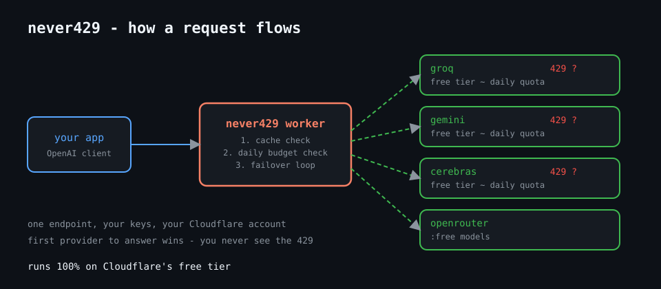

# never429

**One endpoint for every free LLM tier. When one provider rate-limits you, the next one answers.**

An OpenAI-compatible gateway you deploy to your own Cloudflare account in about a minute. It fronts the free tiers of Groq, Gemini, Cerebras, Mistral and OpenRouter with *your* keys, and fails over automatically on `429`, auth errors, timeouts and 5xx. Responses are cached at the edge, and optional daily budget caps stop you from accidentally burning a provider's daily quota.

Runs entirely on Cloudflare's free tier. No server, no Docker, no bill.

[](https://deploy.workers.cloudflare.com/?url=https://github.com/Prajit-22/never429)




## Why not LiteLLM or Portkey?

They are good, and they assume you have somewhere to run a server - Docker, Postgres, Redis. never429 is the same idea for people who don't: a single Python Worker on Cloudflare's free plan. Your provider keys live as secrets in *your* Cloudflare account; there is no third-party proxy in the middle.

| | never429 | LiteLLM proxy | Portkey gateway |
|---|---|---|---|
| hosting | Cloudflare free tier | your server / Docker | your server / Docker |
| cost to run | $0 | server + DB | server |
| failover | yes | yes | yes |
| multiple keys per provider | yes, comma-separated | yes | yes |
| edge response cache | built in | add Redis | add Redis |
| code | ~300 lines of Python | large | large |

## Quickstart

You need a free Cloudflare account and at least one provider API key (all free: [Groq](https://console.groq.com), [Gemini](https://aistudio.google.com), [Cerebras](https://cloud.cerebras.ai), [Mistral](https://console.mistral.ai), [OpenRouter](https://openrouter.ai)).

**Option A - button:** click *Deploy to Cloudflare* above, then add your keys as secrets in the Cloudflare dashboard (Workers → never429 → Settings → Variables and Secrets).

**Option B - wrangler (works fine on Windows):**

```sh
git clone https://github.com/Prajit-22/never429
cd never429
npm install
npx wrangler login
npx wrangler secret put GROQ_API_KEY      # repeat per provider
npx wrangler secret put GATEWAY_KEY       # optional, protects your endpoint
uv run pywrangler deploy   # NOT npm run deploy - plain wrangler does not bundle the Python deps (httpx)
```

Then point any OpenAI client at your worker:

```python
from openai import OpenAI

client = OpenAI(
    base_url="https://never429.<your-subdomain>.workers.dev/v1",
    api_key="<your GATEWAY_KEY>",   # or anything, if you didn't set one
)
print(client.chat.completions.create(
    model="default",
    messages=[{"role": "user", "content": "hello"}],
).choices[0].message.content)
```

Nothing in your app changes except `base_url`.

## Configuration

All optional, set as vars in `wrangler.toml` or the dashboard:

| var | default | what it does |
|---|---|---|
| `MODEL_MAP` | built-in chain | JSON: which upstream model to try, in order, per requested model |
| `DAILY_CAPS` | off | JSON: per-provider daily request caps, e.g. `{"groq": 900}` |
| `CACHE_TTL_SECONDS` | `3600` | edge cache lifetime for identical requests; `0` disables |
| `UPSTREAM_TIMEOUT_SECONDS` | `30` | per-attempt timeout before failing over |
| `GATEWAY_KEY` (secret) | off | if set, clients must send it as their Bearer key |

The default chain for `model: "default"` is Groq → Gemini → OpenRouter (`:free` model), there is a `"fast"` chain with smaller models, and a `"demo"` chain (Gemini first) that makes the failover easy to see. Cerebras and Mistral stay registered in `src/providers.py` if you want them in your own `MODEL_MAP`. Providers without a key are skipped automatically. Have two keys for one provider? Set them comma-separated (`GROQ_API_KEY=key1,key2`) and a dead or exhausted key fails over to the next one before moving down the chain. Check each provider's docs for current model ids and free-tier limits - they change often.

## What you get back

Every response carries debugging headers:

```
x-never429-provider: gemini
x-never429-attempts: groq:http_429,gemini:ok
x-never429-cache: miss
```

If the whole chain is down you get one honest `503` listing every attempt and why it failed - no silent hangs.

`GET /v1/usage` returns today's attempt count per provider (needs the KV binding; behind `GATEWAY_KEY` like every other `/v1/*` endpoint).

Streaming (`stream: true`) works: failover happens before the first token, then the upstream stream passes straight through. Streaming responses are never cached. On both paths a client-side problem (a 400 from the provider) comes back as the upstream's own response, not a generic 503 - the 503 is reserved for the whole chain failing.

## Honest limits

- Daily caps are best-effort. KV counters are eventually consistent, so under heavy parallelism a cap can overshoot slightly. Set caps a little below the real quota.
- The edge cache is per-colo, so the same prompt can still hit upstream more than once globally.
- Free tiers are free because providers say so; they can change the rules. You bring your own keys and your own accounts.
- Failover can't help mid-stream: if a provider dies after tokens started flowing, that response is lost.

## Development

Core logic (`src/gateway.py`, `src/config.py`) is pure Python with zero Cloudflare imports - everything Cloudflare-specific is injected by `src/entry.py`, which is the only file that touches Workers APIs. That is why the whole gateway is testable locally:

```sh
pip install pytest httpx
python -m pytest tests/ -q     # 27 tests
```

`docs/demo-script.md` shows how to record a real failover demo with the included mock server, no API keys needed.

## License

MIT
